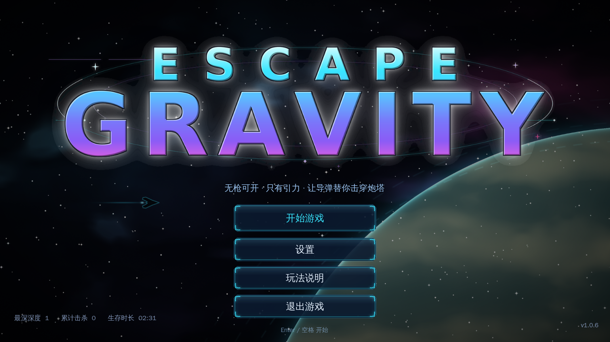
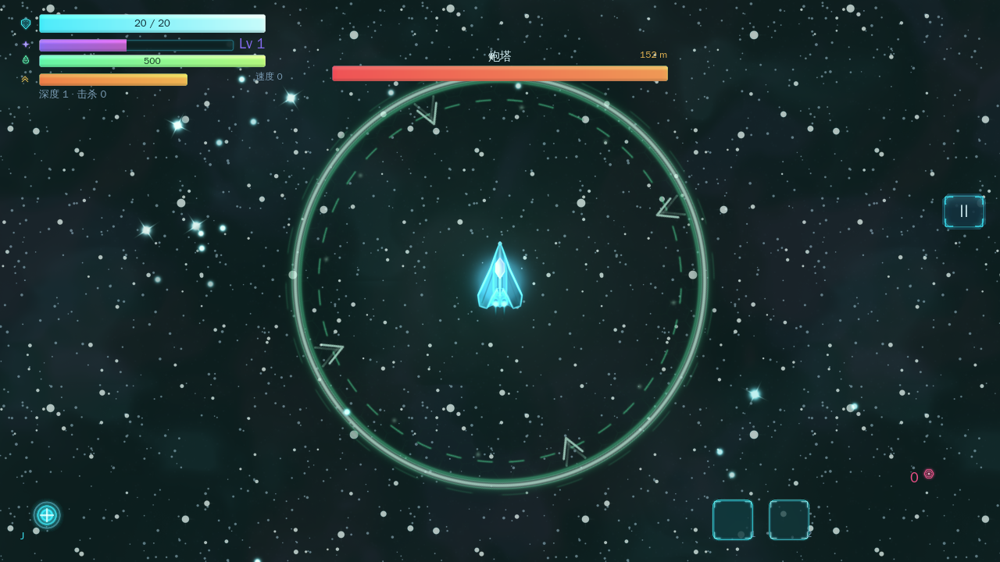
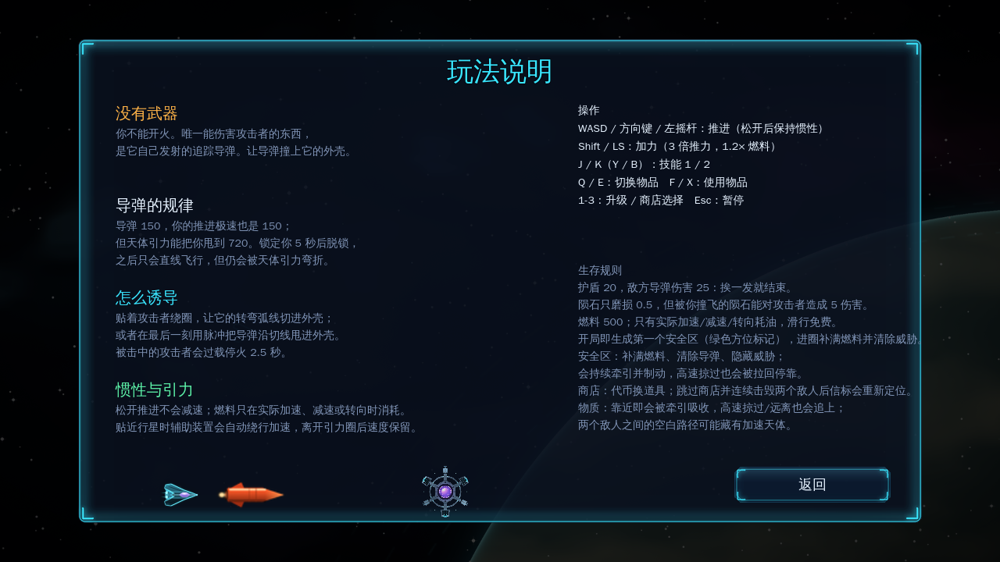
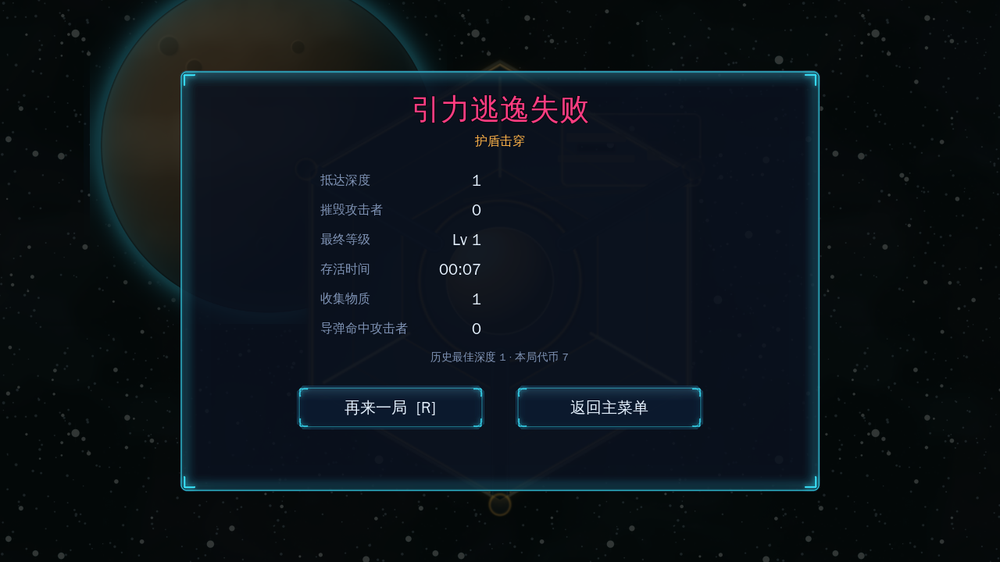
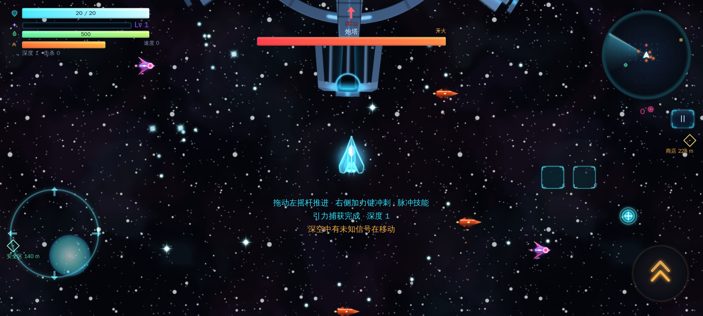
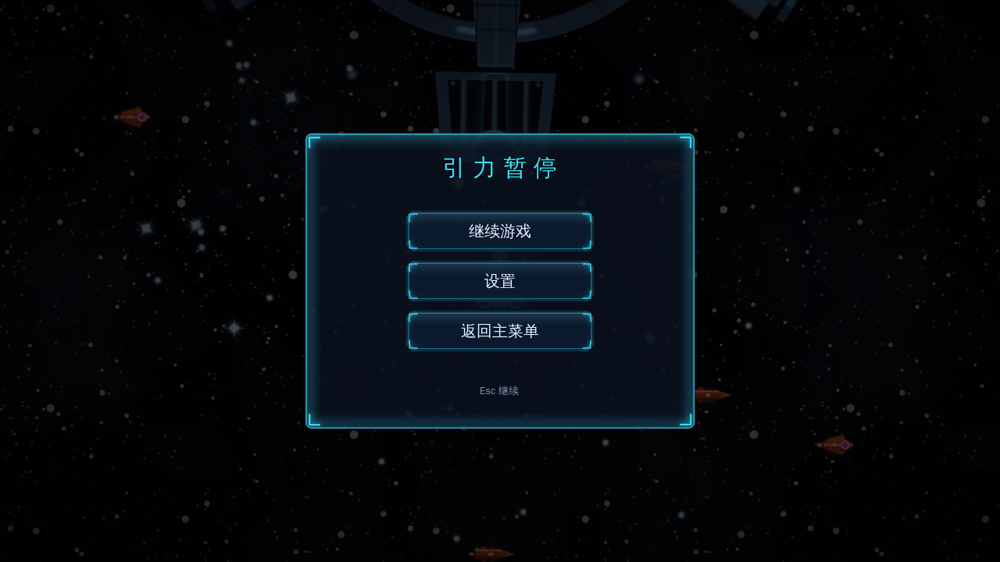

# Escape Gravity · 1.0.9 发行版

[](https://github.com/Moonlark-Dev/EscapeGravity/actions/workflows/build.yml)
[](LICENSE)

> 2D 俯视角 · 物理驱动 · 无直接攻击的太空肉鸽

- 引擎：**Godot 4.7.2**（GL Compatibility，兼顾 Android）
- 分辨率：1280×720 逻辑分辨率，`canvas_items` 拉伸 + `expand` 适配宽屏 / 刘海屏
- 美术：**全部为预渲染图片素材**（PNG），引擎运行时不绘制任何几何图形；UI 由贴图、九宫格与文字组成，粒子同样使用贴图
- 音频：预渲染 WAV（程序化合成占位音频），运行时只播放文件
- 中文字体：WenQuanYi Zen Hei（随包分发，见许可）
- 许可：**MIT**（见 [`LICENSE`](LICENSE)；字体与引擎的第三方许可见 [`THIRD_PARTY_NOTICES.md`](THIRD_PARTY_NOTICES.md)）


### 1.0.9 更新

- **升级挪进安全区**：游玩途中打满经验槽不再弹出升级框，只累积“待升级”次数（HUD 会提示 `待升级 ×N · 进入安全区强化`）；进入安全区后一次结算，攒了几级就连着选几张。安全区内继续吸收物质攒出的新等级会立刻补开面板。这样战斗中途不会被打断，升级也变成“活着到达安全区”的奖励。
- **撞击伤害改为按速度计算**：撞上敌舰或天体时，护盾磨损由撞击瞬间**沿法线的速度**决定（**40 px/s** 起算，**380 px/s** 到顶，基础 **0.5~5**）；**撞敌人 ×1.5**，但撞敌人和撞天体**单次最高都是 5**。贴着表面擦过几乎不掉血，正面高速撞上去才疼。护盾 20 至少能扛 4 次满额撞击。

### 1.0.8 更新

本版从 **1.0.5** 基线重新实现，撤回 1.0.6 / 1.0.7 的“物理甩飞”实验，重做以下四项：

- **物质靠近即吸收**：牵引半径 **260px**；进入后锁定 **5 秒**，并以 **1200 px/s**（高于飞船外部上限 720）直接追向飞船，**40px** 内拾取。高速侧掠、正在远离、从身后掠过都会追上，不再出现“靠近后被甩飞”。
- **安全区改为捕获井**：**700px** 影响圈内不再只给一个很小的向心加速度，而是把速度朝“指向圆心的目标速度”拉（目标速度上限 **520 px/s**，加速度上限 **1600 px/s²**），同时压掉切向速度；整个影响圈内抵消天体引力。高速切线掠过也会被吸进 R280，进圈后由 **1400 px/s²** 反推停靠；玩家明确朝圈外推进时仍可脱离。
- **商店记录线路相对位置**：创建时记录所在路线段与该段敌人深度。玩家没进商店、却先击败该段敌人时，旧信标移除，并在下一段路线商店点重新生成，商店始终随战线前移。
- **空白路径加速天体**：每段路线仍保证一个天体锚点；其中 **42%** 的段尝试把较小的天体（R140~180、横向 ≤160）直接放进两个敌人之间的空白路径，用于切线环绕加速；与安全区/商店/敌人/已生成天体冲突时回退到侧方锚点。

### 1.0.5 更新

- **真惯性物理**：太空不再有阻力，松开推进后飞船保持当前速度；引擎只能把速度推到 **150**（加力 192），超过引擎极速后推进只用于转向/减速，惯性不会被压回。外部速度的安全上限为 **720**。
- **燃料按实际 Δv 计**：只有真正改变速度（加速、减速、转向）时才耗油；到达极速后继续按住推进不耗燃料，滑行完全免费。
- **环绕天体加速**：引力影响半径从 **2R 提高到 3R**，给切线掠过留出足够的弯折时间；贴近行星时辅助装置会沿切线自动绕行加速，离开引力圈后速度保留，可以被甩得比引擎极速快得多。HUD 新增速度读数（超过 192 变青、超过 400 变琥珀）。
- **高速安全区停靠**：辅助装置的反推上限提高到 1400 px/s²；以 600~720 速度进入安全区时会自动刹停，停在 R280 圈内，而不是穿过去。只有明确把推进方向指向圈外时才会放手。
- **生成间距修复**：安全区/商店按完整 R280 贴图、敌人按外壳半径、天体按表面 + 160px 留白做双向避让；路线预置的安全区/商店/敌人会为后续天体预留空间，天体也不会在玩家、安全区或敌人身上流式生成；敌人若被天体挤到会沿径向推出表面。
- **路线落点更稳**：被天体挡住的安全区/商店/敌人会用 18 圈 × 24 方向的环形搜索重新落点，不再直接放弃在原来的错误位置。

### 1.0.4 更新

- **未发现的敌人也会开火**：它仍不显示贴图、不进雷达/方位/血条，但玩家进入仇恨范围后会持续射击。导弹在屏幕外生成，先以切线方向绕一段弧再切入；72% 的射入方向落在敌人方位 ±57° 内，其余全随机，既保留“位置未知”，又给出方向提示。
- **偷袭弹单独计数**：这类导弹同时最多 2 枚，且不占用正常的 3 枚直射名额，避免未发现阶段的火力把正面齐射挤掉。

### 1.0.3 更新

- **安全区改为“靠近才扩张”**：刷新后只是比飞船略大的小环（触发半径 78），玩家飞到中心才触发扩张；扩张第一帧的触发半径就设为完整的 280，动画期间不会误飞出安全区。敌人间距、引力与燃料判定都按完整半径（`clearance_radius()`）计算，扩张后不会把敌人圈进来。
- **敌人发现机制**：攻击者生成后不再立刻出现在贴图、雷达、边缘方位与顶部血条上，也不会开火。玩家进入 2100px 后它开始以 1.5× 速度主动逼近；直到外壳进入屏幕才淡入并显示位置，之后沿用原有的索敌/开火规则。（1.0.4 起改为未发现时也会发射屏幕外偷袭弹。）

### 1.0.2 修复 / 调整

- **安全区不再贴着敌人**：安全区预置点从“上一场战斗旁边”移到相邻两段敌人的中点，横向偏移加大到 470~600px；与两侧敌人的预置间距 ≥1150px，安全区贴图（R280）与炮塔外壳（R420）之间至少留 450px。首段没有上一个敌人，安全区仍落在路线前段，与首个敌人保持距离。
- **安全区刷新会避开正在交战的敌人**：刷新时若敌人进入 520px 贴图间距，安全区自动向外让位（再避开天体）；敌人刷新对安全区的间距校验同步从 400px 提高到 520px。
- **地图生成改为“星系 → 物质 → 隐藏路线”**：先铺星系与天体，再填充物质，然后生成一条只用于布局、不渲染的行进路线；商店、安全区、敌人按路线顺序预生成。路线永不回头，每段尽量经过一个天体的引力圈；两个敌人之间必有一个安全区；商店比安全区离路线更远。
- **导弹全程受天体引力**：锁定中也不再免疫引力，只有玩家的辅助操作装置会自动平衡恒星引力。
- **初始加力槽 ×3**：2.2s → 6.6s。

### 1.0.1 修复 / 调整

- 移动端：标题按钮按真实屏幕中心锚定；技能按钮从左侧移到右侧、加大到 92px，并与加力键/物品栏/代币读数重新排布，避免互相遮挡。
- 敌人进入玩家视野后，导弹从其外壳炮口（炮塔三炮口之一 / 巢的前向口）发射；视野外仍按文档从玩家侧向 820px 进入。
- 碰撞体积对齐贴图：飞船半径 13→40、导弹 7→12、陨石 11→17；导弹巢贴图比例同步改为 `R/124`。
- 无限地图：视差背景改为跟随相机锚定（此前离开初始区块后背景会消失）；增大区块加载半径并保证每个区块至少有一个天体；物质改为围绕飞船持续补给，不再只在出生点附近生成。
- 平衡：初始燃料 240→500；加力耗油从 2× 降为 1.2×（4.8/s）。
- 敌人刷新改为与安全区同向（在玩家—安全区连线的延长线上），并让敌人绕行安全区而不是顶在边缘。

---

## 0. 交付物

| 文件 | 平台 | 大小 | SHA-256 |
|---|---|---|---|
| `dist/EscapeGravity-1.0.9-windows-x86_64.zip` | Windows 10/11 x64 | 57.4 MiB | `e2ed487a…8f9b9776` |
| `dist/EscapeGravity-1.0.9-android-arm64.apk` | Android 7.0+ arm64 | 47.3 MiB | `2c835bd8…f11f84a5` |
| `dist/EscapeGravity-1.0.9-linux-x86_64.tar.gz` | Linux x64（附带） | 48.2 MiB | `14fd61f8…8b059258` |
| `build/windows/EscapeGravity.exe` | 未压缩的 Windows 单文件 | 125.9 MiB | `9d77ec22…9d6830f4` |
| `build/android/EscapeGravity.apk` | 未重命名的 Android 包 | 47.3 MiB | `2c835bd8…f11f84a5` |
| `docs/shots/*.png` | 由**导出包**实际运行的截图 | — | — |

完整校验和：`dist/SHA256SUMS.txt`。Windows / Linux 压缩包内附带 `LICENSE`、`THIRD_PARTY_NOTICES.md` 与 `LICENSES/`。

- Windows 1.0.9 直链：[EscapeGravity-1.0.9-windows-x86_64.zip](https://files.thisisxd.top/d/EscapeGravity-1.0.9-windows-x86_64.zip)
- Android 1.0.9 直链：[EscapeGravity-1.0.9-android-arm64.apk](https://files.thisisxd.top/d/EscapeGravity-1.0.9-android-arm64.apk)

**自动构建**：每次推送到 `main`，GitHub Actions 会跑 140 项无头自测、导出 Windows / Linux 可执行文件并上传工件
（`escape-gravity-dist`、`EscapeGravity-windows-x86_64`、`EscapeGravity-linux-x86_64`）；推送 `v*` tag 时自动把
`dist/*` 附到 GitHub Release。下载入口：

- Actions 工件：<https://github.com/Moonlark-Dev/EscapeGravity/actions/workflows/build.yml>
- Releases：<https://github.com/Moonlark-Dev/EscapeGravity/releases>

> 下表是本次 1.0.9 重新构建的交付包，`build/` 与 `dist/` 均来自同一次构建。

Windows 包为单文件 exe（内嵌 PCK），解压即玩，无需安装。Android 包已用项目自带密钥签名（v2/v3），可直接侧载安装。

本版不再提供 Web 试玩包；正式交付为 Windows / Android 原生构建。

- Android 包名：`com.escapegravity.game`，versionCode 12，versionName 1.0.9
- minSdk 24 / targetSdk 36（Godot 4.7 模板），仅 arm64-v8a
- Windows 构建未做商业代码签名：首次运行可能出现 SmartScreen 提示，选择“仍要运行”即可

---

## 1. 怎么玩



### 操作

| 动作 | 键鼠 | 手柄 | 触屏 |
|---|---|---|---|
| 推进（有惯性） | `W A S D` / 方向键 | 左摇杆 | 左摇杆 |
| 加力（3× 推力、1.2× 燃料） | 按住 `Shift` | 按住 `LS` / `RB` | 右下加力键 |
| 技能 1 / 2 | `J` / `K` | `Y` / `B` | 右侧技能按钮 |
| 切换物品 | `Q` / `E` | `LB` / `RB` | 点击物品格 |
| 使用物品 | `F` | `X` | 再点一次已选中的物品格 |
| 暂停 | `Esc` / `P` | `Start` | 右上暂停键 |
| 升级 / 商店选择 | `1` `2` `3` | — | 点击 |
| 天花板菜单 | 点击按钮 / `Enter` | `A` | 点击 |
| 失败后重开 | `R` | — | 点击“再来一局” |

### 一局在干什么


1. 星域里潜伏着一台比屏幕还大的**炮塔**。它在进入你的屏幕前不会显示位置，也不会出现在雷达上；你靠近后它开始逼近，同时从屏幕外发射绕弧切入的导弹——导弹的射入方向通常偏向它所在的一侧。导弹锁定你 **5 秒**后脱锁，之后只能直线飞行，而且从出膛到自毁都持续受天体引力影响。
2. 你打不到炮塔。唯一能伤到它的，是**它自己的导弹**：贴着炮塔绕圈，让导弹的转弯弧线切进外壳；或者用脉冲把导弹沿切线甩进外壳。
3. 导弹撞上炮塔：**25 点伤害** + 炮塔过载停火 2.5 秒；炮塔血量 50，两发即可摧毁。
4. 炮塔爆炸后掉落大量**物质**，正常接近会自动吸收并填经验槽。每 **20 XP** 升一级，但**升级只在安全区结算**：游玩途中只累积次数（HUD 提示 `待升级 ×N`），进站后一次三选一，攒了几级就连着选几张。即使你以高速从物质旁掠过或正在远离，牵引场也会追上并把它吸收，不会再出现物质被甩飞的情况。
5. 燃料有限，但**开局前方就有一个安全区**（绿色方位标记）；进入后会补满燃料并清除威胁，离开 10 秒后刷新下一个。**安全区**会补满燃料、清除导弹与陨石、屏蔽雷达与威胁指示；它刷新时只是一个比飞船略大的小环，飞到中心才扩张成完整的补给圈。即使高速切线掠过、从边缘滑过，安全区也会持续牵引并拖慢你，把你拉回 R280 内停靠，不再会被甩飞；明确朝圈外推进时可以脱离。**商店**用代币换道具；如果跳过商店并击败它所在路段的敌人，信标会自动重新定位。地图生成时会沿一条隐藏路线预置它们的位置：安全区在两个敌人之间，商店离路线更远；路线本身不显示给玩家。两个敌人之间的空白路径有时会生成一颗小**加速天体**，可以借它做切线环绕。
6. 摧毁一个攻击者后进入 **8 秒安全时间**，随后按路线顺序刷新更强的敌人；深度递增。

护盾只有 **20**，而敌方导弹伤害是 **25**：**挨一发就结束**。陨石只磨损 0.5，但你可以把陨石撞飞，让它对敌人造成 5 点伤害。

### 技能

| 技能 | 冷却 / 燃料 | 作用 |
|---|---|---|
| 脉冲 | 5s / 10 | 以飞船为圆心，范围内导弹脱锁并获得 200 切线冲量（±15°）；以玩家移动方向画分界线：导弹在左侧则向左偏转、右侧向右偏转（静止时按面向） |
| 引力锚 | 9s / 15 | 在前方生成持续 4 秒的引力源，把导弹拉向它（升级 +半径/时长） |
| 相位滑行 | 7s / 12 | 向输入方向瞬间冲刺（升级 +速度/时长） |
| 诱饵信标 | 11s / 16 | 投放信标，锁定你的导弹转火信标，抵达后脱锁 |

初始只有脉冲；升级可解锁第二个技能槽，之后升级可强化已有技能（最高 3 级）。

### 道具

| 道具 | 稀有度 | 作用 |
|---|---|---|
| 备用能源 | 稀有 | 恢复 60 燃料 |
| 护盾补片 | 普通 | 恢复 6 护盾 |
| 干扰弹 | 稀有 | 身后释放，把附近锁定导弹向两个斜前方甩开 |
| 诱饵弹 | 史诗 | 前方投放诱饵，锁定导弹转火；信标受引力影响 |
| 紧急充能装置 | 传说 | 立即回满加力槽 |
| 复活币 | 传说 | 被动：护盾归零时消耗，以 8 护盾复活一次 |

---

## 2. 按设计文档实现的系统



| 文档条目 | 实现 |
|---|---|
| 惯性推进 / 引擎极速 150 / 推力 380 / 太空无阻力 | `src/ship.gd`：加速度积分；松开推进保持速度；超过 150 后推进只能转向/减速；外部速度上限 720 |
| 加力：3× 推力、1.28× 极速、槽 6.6s、0.7s 后回充、剩余 0.22 才能再启 | 全部实现；初始槽为旧 2.2s 的三倍；回充只看是否在加力，推进中同样回充；耗尽后需先松开加力键再点火；燃料 1.2×（4/s vs 4.8/s）；加力推力=1140 |
| 引力：M=24e6×(r/290)²、内圈 0.85r 夹紧、影响半径 3r、外侧 15% 平滑 | `src/gravity_body.gd`；表面 285、内圈 395、3r 外为 0；对飞船、导弹、陨石生效；导弹锁定中同样受引力 |
| 辅助操作装置平衡恒星引力、引导环绕天体 | `galaxy.gravity_at(pos, for_ship=true)` 仅在贴近恒星时把引力施加给飞船；导弹没有辅助装置 |
| 敌人：视野外 240 / 内 18；未进屏隐藏、不进雷达/方位/血条；靠近 2100px 后主动逼近并开火 | `src/enemy.gd`；炮塔 R420/HP50，视野外 5s 齐射、视野内 1s，45% 单发，0.2s 间隔；位置按隐藏路线顺序取；未发现时以 1.5× 速度逼近，进屏淡入 0.35s |
| 偷袭弹：未发现时从屏幕外绕弧切入，方向 72% 偏向敌人方位 ±57° | `enemy._fire_hidden`；屏幕边缘外 180~320px 生成、切线初速；单独上限 2 枚，不占 3 枚直射名额 |
| 导弹：速度 150、转向 0.525 rad/s、屏幕内 5s 脱锁、脱锁后直线且全程受引力 | `src/missile.gd`；转向半径 ≈286px；锁定中引力可以压过转向 |
| 同时锁定上限 3（超过则停火）；未发现阶段的偷袭弹另计 2 枚上限 | 炮塔/巢按 3 枚直射上限判断；`sneak` 导弹单独计数，脱锁后让出名额 |
| 导弹撞敌人：25 伤害 + 过载 2.5s + 停火 | `run.damage_enemy` / `enemy.take_hit` |
| 导弹入场：视野外垂直进入；视野内从敌人外壳炮口发射 | `enemy._fire_one`；视野内炮塔选最近的三个炮口之一、巢用前向口；视野外保持 820px 侧向进入 |
| 陨石：10s/颗、R17、110~210 速度、镜头外 900 进入、方向避开炮塔、受天体与飞船引力、0.5 伤害、撞飞后对敌人 5 伤害 | `src/meteor.gd` + `run`；撞飞船不会立刻消失，可继续飞行撞敌人 |
| 物质：200/星域、吸取 260、小 1 XP / 大 3 XP、每 20 XP 升级（只在安全区结算）；靠近即吸收 | `src/matter.gd`；牵引速度上限 1200、5s 牵引锁定、40px 拾取；初始与补充刷在未探索区，总数上限 280 |
| 护盾 20 / 敌方导弹 25；陨石 0.5 | `src/ship.gd` + `run.hurt_ship` |
| 出生区：开局生成第一个安全区，首个攻击者仍在路线首段 | `run._initial_spawn`：先建安全区，再生成敌人，最后放商店；首个安全区与敌人保持 1220px 间距，离开后 10 秒刷新下一个 |
| 安全区：进入前 R78 → 进入时扩张到 R280、向心牵引、回满燃料/清导弹/清陨石/隐藏雷达与威胁指示、离开后 10s 刷新 | `src/zone.gd` + `run._zone_checks`；进入瞬间触发半径即为 280；影响圈内用目标速度把飞船拉向圆心并压掉切向速度，高速掠过也会被吸回；进入后 1400 px/s² 停靠，圈内抵消天体引力 |
| 安全区吸附：高速切线/边缘掠过仍会被拉回停靠 | `run.assist_accel` 在 700px 影响圈内用捕获井把速度拉向圆心，并压掉切向速度；玩家明确朝圈外推进时放开；进圈后由 1400 px/s² 反推停靠 |
| 安全区刷新在路线预置点 | `RunRoute.safe_at`：每个敌人之间一个；找不到路线时回退 `find_unexplored_point(700, 1875)` |
| 商店：R280、不回燃料、代币交易；绑定创建时的敌人深度 | `run._open_shop` / `buy_offer`；3 件商品，价格按稀有度；位置取路线预置点，离路线比安全区更远 |
| 商店自动重定位 | 跳过商店并击败所属敌人（`depth > shop_bound_depth`）时，`_maybe_refresh_shop` 在下一个路线商店点重新生成 |
| 燃料耗尽：仍可惯性/引力移动；屏幕内有安全区则被吸入；否则 12s 后结束 | `run._check_fuel` + `assist_accel` |
| 操作辅助装置：绕天体切线加速、商店/安全区停靠、燃料 0.4/s、不改变朝向 | `run.assist_accel`；环绕加速在 600 速度处淡出，安全区反推上限 1400 px/s² |
| 碰撞：玩家不能进入天体/敌人、被弹飞；护盾磨损按撞击法线速度 0.5~5，撞敌人 ×1.5、单次最高 5 | `ship.bounce_from` + `run.collision_damage`；40~380 px/s 线性映射；0.35s 受击无敌帧避免连续扣血 |
| 物品栏：基础 2、最多 5、满了要销毁一件 | `run.add_item` / `destroy_and_take` + HUD 销毁面板 |
| 升级池：修复 25%/100%、燃料 25%/上限 +10/+20、物品栏、代币 1/2/3、加力槽 +10%、加力推力 +7%、道具、技能 | `src/defs.gd`；上限后对应卡不再出现 |
| 代币：击败非小型敌人 25% 掉落；狂暴（在视野内）击败必掉 | `run.kill_enemy`；精英必掉 |
| 雷达：安全区/商店/威胁/敌人（敌人仅在 discovered 后显示），超出范围显示方向；已探索/未探索背景不同 | `src/ui.gd`：探索格显示 + 边缘方向 |
| 威胁弧：以玩家为圆心的弧、颜色表示距离、敌人进屏后隐藏 | `ui._refresh_threats`；90° 弧带，红→青 |
| 敌人血条顶部中间；发现后显示（含视野外距离）；方位箭头贴屏幕边（20px） | `ui`：血条、方位箭头、距离 |
| 菜单 / 暂停 / 设置 / 玩法说明 / 结算 | `src/menu.gd` + `src/ui.gd` |
| 无限地图、程序化星系数、行星不是孤立生成 | `src/galaxy.gd`：7800px 星系统 + 2048px 区块，避免重叠，区块流式加载 |
| 地图生成：星系 → 物质 → 隐藏路线 → 商店/安全区/敌人 | `src/route.gd` 预生成路线与节点；`galaxy._generate_chunk` 为该区块的路线段补天体；42% 的段尝试把天体放进两个敌人之间的空白路径（R140~180、横向 ≤160），冲突时回退侧方锚点；路线不创建任何可见节点 |
| 敌人按路线顺序刷新、被击败后显示安全倒计时再刷新 | `RunRoute.enemy_at` + `run.safe_timer`；两个敌人位置之间必有安全区 |
| UI 布局：左上护盾/经验/燃料、右上雷达、顶部中敌人血条、右下物品栏、左下技能 | 与概念图一致；含移动端重排 |

### 关键数值

| 项 | 值 | 项 | 值 |
|---|---|---|---|
| 飞船极速 / 加速度 / 碰撞半径 | 150（加力 192，外部上限 720）/ 380 / 40 | 导弹速度 / 转向 / 锁定 | 150 / 0.525 / 5s |
| 加力推力 / 极速 / 槽 | 1140 / 192 / 6.6s | 导弹伤害（敌/我） | 25 / 25 |
| 燃料上限 / 推进 / 加力（按实际 Δv） | 500 / 4/s / 4.8/s | 炮塔半径 / 血量 | 420 / 50 |
| 天体半径 / 表面引力 / 内圈 | 200~380 / 285 / 395 | 炮塔射速（外/内） | 5s / 1s |
| 引力影响半径 | 3.0 × R | 过载时长 | 2.5s |
| 陨石间隔 / 伤害 / 半径 | 10s / 0.5 / 17 | 炮塔移动（外/内） | 240 / 18 |
| 吸取半径 / XP | 260 / 20 每级 | 安全区（进入前→扩张）/ 捕获 | 78 → 280 / 捕获井 |
| 物质牵引速度 / 锁定 | 1200 / 5s | 安全区影响圈 / 停靠反推 | 700 / 1400 |
| 物质拾取半径 / 牵引 | 40 / 磁吸捕获 | 安全区捕获 / 停靠反推 | 1600 / 1400 |
| 商店绑定 / 自动重定位 | 创建时深度 / 跨过所属敌人 | 空白路径天体 | 42% · R140~180 · 横向 ≤160 |
| 脉冲：冷却 / 燃料 / 半径 / 冲量 / 偏转 | 5s / 10 / 300 / 200 / ±15° | 巢：半径 / 血量 / 齐射 | 300 / 40 / 3 |

---

## 3. 美术与音频：全部是预渲染素材


**硬性约束（按你的要求）：引擎在游戏中不现场绘制任何图形。** 代码里没有 `_draw()`、`draw_*`、`ColorRect`、`Polygon2D`、`Line2D`：
所有实体、背景、UI 边框、条形、雷达、摇杆、特效都是 `assets/` 下的 PNG；UI 由 `NinePatchRect`、`TextureRect`、`TextureProgressBar`、
`Label` 与粒子贴图组成；背景是三层无缝星云/星点贴图按视差平铺；爆炸是两张预渲染火球贴图做缩放/淡出。

这意味着替换美术时**不需要改游戏逻辑**，只要按同名同尺寸替换文件即可。完整契约见 [`docs/ART.md`](docs/ART.md) 与
[`docs/ASSET_MANIFEST.md`](docs/ASSET_MANIFEST.md)。

- 世界贴图：46 张（飞船、导弹、炮塔、巢、陨石、物质、三种行星、恒星、安全区、商店站、诱饵、引力环、冲击波、爆炸、星云、星点、标题背景等）
- UI 贴图：58 张（面板/按钮/卡片九宫格、条、雷达、威胁弧、图标、摇杆、Logo、应用图标等）
- 音频：23 个 WAV（2 首循环 BGM + 21 个音效）
- 字体：WenQuanYi Zen Hei（`assets/fonts/ui.ttc`）

素材全部由 `tools/gen_assets_world.py`、`tools/gen_assets_ui.py`、`tools/gen_audio.py` 程序化生成，`tools/post_assets.py` 做后期修整
（星云提亮、行星裁剪、爆炸序列重绘）。后续换成美术图时，可以用任何工具覆盖同名文件，然后重新导入/导出。

---

## 4. 工程结构

```
escape-gravity-release/
├── .github/
│   ├── actions/setup-godot/  # 下载并缓存 Godot 与导出模板
│   └── workflows/build.yml   # 自测 + Windows/Linux 导出 + 工件 + Release
├── project.godot             # 4.7 / GL Compatibility / 1280x720 / 自动加载
├── export_presets.cfg        # Windows / Linux / Android 导出预设（不含签名口令）
├── LICENSE                   # MIT
├── scenes/main.tscn          # 单场景入口
├── src/
│   ├── consts.gd             # 全部平衡数值与调色板
│   ├── defs.gd               # 道具、技能、升级池
│   ├── main.gd               # 应用外壳：标题 / 开一局 / 暂停 / 淡入淡出 / 截图模式
│   ├── menu.gd               # 标题、暂停、设置、玩法说明
│   ├── ui.gd                 # 局内 HUD、雷达、威胁弧、摇杆、升级/商店/销毁/结算
│   ├── run.gd                # 单局主控：状态机、生成、碰撞、升级、商店、燃料、深度
│   ├── galaxy.gd             # 程序化星系、区块流式加载、探索网格、刷新点
│   ├── route.gd              # 隐藏行进路线：商店/安全区/敌人预置点
│   ├── gravity_body.gd       # 行星/恒星与引力公式
│   ├── ship.gd               # 惯性、加力、燃料、护盾、辅助
│   ├── missile.gd            # 追踪导弹
│   ├── enemy.gd              # 炮塔 / 导弹巢
│   ├── meteor.gd / matter.gd / zone.gd / decoy.gd / anchor.gd / fx.gd
│   ├── assets.gd / audio.gd / store.gd / controls.gd
│   ├── backdrop.gd           # 视差星云/星点
│   └── selftest.gd           # 140 项无头断言 + 机器人可玩性验证
├── assets/                   # world / ui / audio / fonts
├── tools/                    # 素材生成、后期、构建、打包
├── docs/                     # ART.md / DESIGN_MAP.md / QA.md / 资产清单 / 截图
├── keystore/                 # 本地 Android 签名材料（gitignored）
└── build/ dist/              # 导出产物 / 发布包（gitignored）
```

技术要点：

- **不用物理引擎**：自己的速度积分 + 圆-圆碰撞，数值与文档一致，也便于无头模拟和机器人测试。
- **状态机**：`PLAYING / LEVELUP / SHOP / DESTROY / DEAD`，暂停由外壳控制；过场用黑色贴图淡入淡出。
- **世界流式**：2048px 区块；远处区块卸载，天体节点复用贴图。
- **所有随机**都由 `RandomNumberGenerator` 播种，便于复现。
- **截图/自测模式**：`-- --selftest` 跑断言；`-- --shots=目录` 用导出包真实渲染截图；`-- --touch` 强制触屏 UI。
- 存档在 `user://escape_gravity.cfg`：设置、最佳深度、击杀、时长；Windows 位于 `%APPDATA%/Godot/app_userdata/Escape Gravity/`，Android 位于应用私有目录。

---

## 5. 验证

### 5.1 无头断言（140/140 通过）

```bash
godot --headless --path . -- --selftest
# RESULT: 140 checks, 0 failed
```

覆盖：太空无阻力与惯性保持 / 引擎极速 150、加力 3× 与 192、外部上限 720 / 燃料按实际 Δv（滑行免费，到极速后按住推进不耗油）/ 加力槽 6.6s 与推进中回充 / 引力 285·395·3R 截止 /
辅助装置平衡恒星引力 / 锁定中的导弹仍受引力弯折 /
导弹 150·0.525·5s 脱锁 / 命中 25 与过载 / 陨石 0.5 与撞飞 5 / 物质 260 与 1·3 XP / 高速远离仍被追上吸收 / 20 XP 升级（游玩中只累积，进安全区才弹卡） / 撞击伤害按速度·撞敌人×1.5·单次最高 5 /
安全区 78→280 扩张·补满·清弹·隐藏·10s 刷新 / 高速切线掠过仍被吸入·径向高速仍能停靠 / 商店 3 件且不回燃料·跨过所属敌人后自动重定位 / 开局安全区 / 物品栏 2→5 与满栏销毁 / 脉冲 10 燃料·200 冲量·5s CD·按移动方向左右偏转 /
诱饵抵达脱锁 / 干扰弹偏转 / 燃料 12s 判负 / 复活币 / 路线不回头·商店更远·每段有天体·两个敌人间有安全区·安全区离敌人≥1150 / 空白路径加速天体数量与间距 /
敌人未发现时不可见、仇恨范围外不开火、靠近后逼近 / 未发现时仍开火且导弹从屏幕外弧线切入·方向偏向敌人·单独上限 2 / 进屏即发现并淡入 /
起始区域按路线落位 / 敌人按路线顺序刷新 / 120000px 外仍有天体 / 初始燃料 500。

### 5.2 机器人可玩性

机器人只做“绕圈 + 直射导弹贴脸时释放脉冲”（偷袭弹不占用脉冲）：

| 条件 | 结果 |
|---|---|
| 无敌机器人（排除死亡干扰） | **3/3 次击毁炮塔**，用时 11.4~56.6s（新物理下绕圈更慢，但都能完成诱导） |
| 普通机器人（20 护盾，一次死亡即结束） | **1/3 次击毁**，seed 202 用时 10.9s；另外两次分别在 8.5s / 21.5s 被导弹击穿 |

> 机器人测试在无天体干扰的空场地进行，只验证“绕圈诱导 + 贴脸脉冲”这一核心循环；天体引力与环绕加速由独立断言覆盖。

结论：**“只能靠诱导导弹撞敌人”的核心循环是可达成的**；同时也说明本作确实是“一击结束”的高压难度（文档要求）。

### 5.3 导出包验证

> 本次 1.0.9 重新导出了 Linux / Windows / Android 包并重打了 `dist/`，下方验证均针对这批产物。

- Linux 导出包在 `Xvfb + llvmpipe` 下真实运行并重新生成全部 11 张截图（不是编辑器截图），中文字体、脚本、贴图、音频均从 PCK 加载。
- Windows 产物：`PE32+ executable (GUI), x86-64`，尾部 `GDPC` 内嵌包标记，单文件无外部依赖。
- Android：`apksigner verify` 通过（v2 + v3 签名）；`aapt2 dump badging` 显示 `com.escapegravity.game`、1.0.9（versionCode 12）、
  minSdk 24、targetSdk 36、`native-code: arm64-v8a`、landscape、无危险权限；APK 内含全部贴图/字体/音频/脚本。

### 5.4 界面

| | |
|---|---|
|  标题 |  玩法说明 |
|  战斗 HUD |  威胁弧与方位 |
|  升级三选一 |  商店 |
|  安全区 |  结算 |
|  触屏布局 |  暂停 |

---

## 6. 和设计文档的差异 / 取舍

完整逐条对照见 [`docs/DESIGN_MAP.md`](docs/DESIGN_MAP.md)。这里列需要你知道的。

1. **代币按货币计数**，不占物品栏。文档写“代币也是一种物品”，但 2 格基础物品栏里放代币会直接卡死商店体验；HUD 右上角单独计数。
2. **新增内容**（文档只给了示例）：
   - 技能：引力锚、相位滑行、诱饵信标（脉冲为文档示例，其余为同一设计语言下的扩展；均有数值与等级）；
   - 第二个非小型敌人“导弹巢”（R300/HP40、3 发齐射、锁定上限 4），与炮塔按深度交替；
   - 精英炮塔（每 5 层，血量 ×1.6）。
3. **导弹入场**：视野外保持文档规定的“垂直于敌人—玩家连线、玩家侧向 820px 进入”；视野内改为从炮塔最近的炮口 / 导弹巢前向口发射。锁定期间导弹不与来源敌人碰撞，避免刚出膛就自爆。
4. **技能替换**未做：升级只能解锁 / 强化，不能替换已有技能（文档提到“可升级或替换”）。这是发行版的一处未完成项。
5. **激光**未实现：文档在“攻击者通用机制”提到激光，但炮塔示例只有导弹；当前过载表现为停火。没有加入激光以避免与一击必杀叠加成不可玩难度。
6. **无中途存档 / 无云存档 / 无 meta 解锁**：只有设置与历史最佳记录持久化。一局结束即结算。
7. **商店 NPC** 只有一句台词式交互与交易面板，没有对话树。
8. **UI 仅中文**；没有做多语言。
9. **美术/音频为程序化生成的预渲染占位素材**：已按可替换资产管线实现，后续换图不需要改逻辑。
10. **Android 仅 arm64**，且没有真机实测（本机无 Android 设备；APK 已做静态与签名验证，Linux 导出包做了真实运行验证）。
11. 安全区/商店刷新距离、商店重开时间（26s）等文档未给定的细节由本实现确定，见 `DESIGN_MAP.md`。
12. 1.0.9 在 1.0.8 基础上把升级挪进安全区、撞击伤害改为按速度计算；1.0.8 则是从 1.0.5 基线重做：物质磁吸捕获、安全区捕获井、商店随战线重定位、空白路径加速天体。数值集中在 `src/consts.gd`，这些行为都有自测覆盖。

---

## 7. 构建

依赖：

- Godot 4.7.2（headless 即可）+ 4.7.2 导出模板（Windows / Linux / Android）
- JDK 17、Android SDK（build-tools 35、platform 35/36，仅 Android 需要）
- 已配置 Godot Editor Settings 的 `export/android/android_sdk_path` 与 `java_sdk_path`（或设置 `ANDROID_HOME` / `JAVA_HOME`）

```bash
# 自测
godot --headless --path . -- --selftest
# Windows（单文件，内嵌 PCK）
godot --headless --path . --export-release "Windows Desktop" build/windows/EscapeGravity.exe
# Linux（用于无显示环境验证）
godot --headless --path . --export-release "Linux (verification)" build/linux/EscapeGravity.x86_64
# 打包 dist + 校验和（CI 使用 windows,linux）
python3 tools/make_dist.py --platforms windows,linux
```

Android 签名：`export_presets.cfg` 只保存密钥路径与别名，**口令从环境变量读取**：

```bash
source keystore/env.sh   # 本地签名文件，与整个 keystore/ 一起被 .gitignore 排除
JAVA_HOME=/path/to/jdk17 godot --headless --path . --export-release "Android" build/android/EscapeGravity.apk
```

一键脚本：`bash tools/build_all.sh`（存在 `keystore/env.sh` 时连 Android 一起构建，否则跳过 Android）。

**CI**：`.github/workflows/build.yml` 在 `ubuntu-24.04` 上下载并缓存 Godot 4.7.2 与导出模板，依次执行资源导入、源码自测、Windows/Linux 导出、导出包自测、`make_dist.py --platforms windows,linux`，然后上传三个工件：

- `escape-gravity-dist`：Windows zip、Linux tar.gz、`SHA256SUMS.txt`
- `EscapeGravity-windows-x86_64`：未压缩的 `EscapeGravity.exe`
- `EscapeGravity-linux-x86_64`：未压缩的 `EscapeGravity.x86_64`

推送 `v*` tag 时，`release` job 会把 `dist/*` 附到 GitHub Release。CI 不接触 Android 签名材料，APK 建议在本地用 `keystore/` 导出。

---

## 8. 已知问题 / 后续建议

- 机器人测试显示难度依然偏高（普通机器人 3 次里 1 次击毁）；人类可用加力、物品与脉冲做得更好，但如果你希望更“亲民”，建议先在 `src/consts.gd` 调 `SHIP_SHIELD_MAX`（20→30）或降低 `TURRET_FIRE_IN` 的密度，再跑自测。
- 未在真实 Android 设备/手柄上验证；触屏布局已在 16:9 与 20:9 逻辑分辨率下截图检查。
- 低端 Android 的帧率未做基准测试；如出现掉帧，优先减少 `matters` 数量（`run._initial_spawn` / `scatter_matter`）与星云层数。
- 音效为程序化合成占位，未做母带；BGM 循环接缝已做交叉淡化检查，但未人耳试听。
- 触屏没有做“手柄 UI 焦点导航”；菜单需要点击/触摸。
- `docs/ASSET_MANIFEST.md` 是初版素材契约，补充的图标（护盾补片/复活币/物品栏/通用技能/黑色/白色/应用图标）在 `ART.md` 中列出。

---

## 9. 许可与致谢

- **游戏代码、程序化生成的占位美术与音频**：**MIT License**，见 [`LICENSE`](LICENSE)。可自由使用、修改、再分发与商用；美术/音频为程序生成，不含第三方素材。
- **Godot Engine** © Godot Engine contributors，MIT License。
- **WenQuanYi Zen Hei** © 2007–2009 Qianqian Fang 与文泉驿项目，GPL-2 with Font embedding exception；完整许可见 `licenses/WenQuanYi-ZenHei.txt`。
- 设计文档：《Escape Gravity（暂定名）设计文档》，游戏按此实现。
- 灰盒参考：早期技术验证版（程序化绘制，未随本仓库分发）；本版重写为资产驱动。

完整第三方声明见 [`THIRD_PARTY_NOTICES.md`](THIRD_PARTY_NOTICES.md)。
