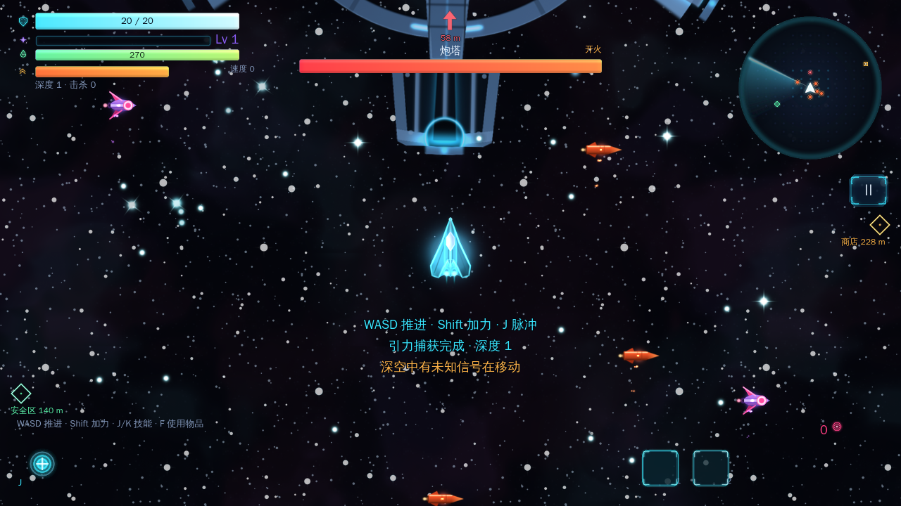
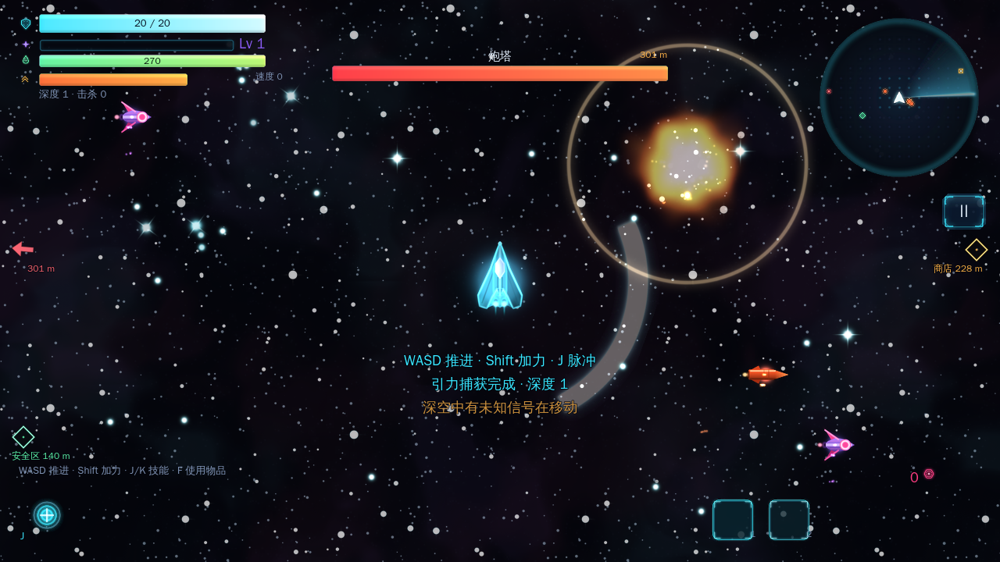
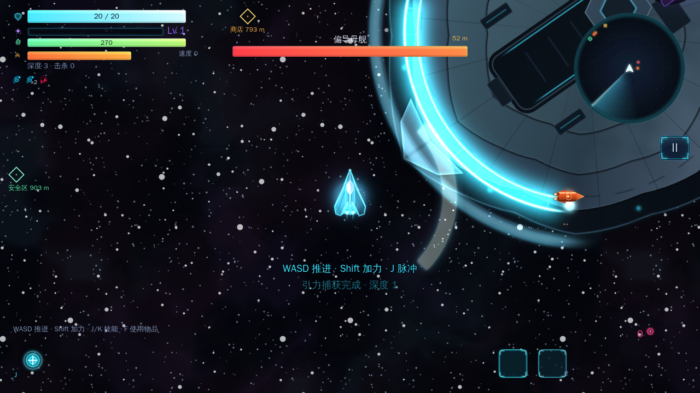
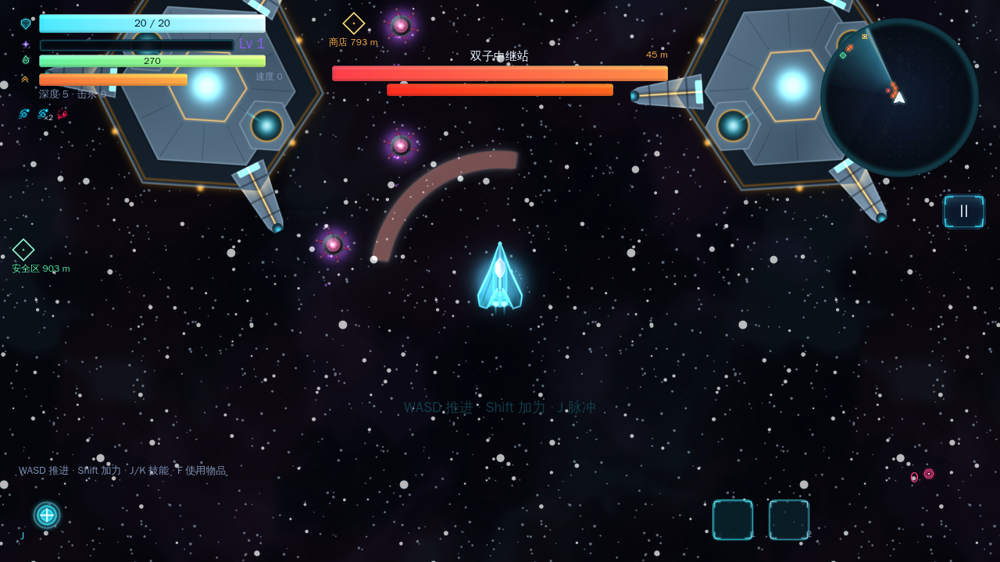

# Escape Gravity · 1.4.0

[](https://github.com/Moonlark-Dev/EscapeGravity/actions/workflows/build.yml)
[](LICENSE)

> 2D 俯视角 · 物理驱动 · 无直接攻击的太空肉鸽

- 引擎：**Godot 4.7.2**（GL Compatibility，兼顾 Android）
- 分辨率：1280×720 逻辑分辨率，`canvas_items` 拉伸 + `expand` 适配宽屏 / 刘海屏
- 美术：**全部为预渲染图片素材**（PNG），引擎运行时不绘制任何几何图形；UI 由贴图、九宫格与文字组成，粒子同样使用贴图
- 音频：预渲染 WAV（程序化合成占位音频），运行时只播放文件
- 中文字体：WenQuanYi Zen Hei（随包分发，见许可）
- 许可：**MIT**（见 [`LICENSE`](LICENSE)；字体与引擎的第三方许可见 [`THIRD_PARTY_NOTICES.md`](THIRD_PARTY_NOTICES.md)）

## 更新日志

### 1.4.0 更新

本版按试玩反馈调整成长节奏与操作体验，并修掉导弹穿过敌舰的穿模。

- **升级更慢**：每级所需经验 **20 → 100（×5）**。同样一局里升级次数明显减少，升级卡的分量更重。
- **燃料槽定为 270**：上限 **500 → 270**。安全区仍会补满燃料，**备用能源（+60）**、燃料上限卡（+40 / +80）与「节能巡航」仍是续航补充；滑行仍然免费。
- **导弹锁定期改为“绕飞 + 实体外壳”**：锁定中把所有敌舰外壳当成障碍，提前 220px 预测航向、在会擦到外壳时改走切线，并硬性禁止弹体穿进外壳。以前那点偏转方向算反了，玩家用引力快速绕一圈时导弹会直接从敌人正中间穿到另一侧；现在它会贴着外壳滑过去。绕不开的导弹仍会在碰撞结算里真的打在外壳上，脱锁后也照常可以撞回发射者——诱导伤害循环不受影响。
- **双子节点生成间距 ×2**：双子中继站两座之间的生成/公转间距 **750 → 1500px**，两座不再挤在一起。
- **PC 手柄键位提示**：`Controls` 记录最近一次真正操作的设备（键盘/鼠标 vs 手柄按键/摇杆），键位提示按设备切换：用手柄时只显示手柄键位（左摇杆、RB、Y/B、X、方向键、Start、A），用键鼠时只显示键盘键位。覆盖 HUD、技能角标、物品提示、暂停/商店/升级/替换/觉醒/丢弃/结算面板。
- **手柄可操作面板**：方向键（←/↑/→/↓）直接选升级/商店/替换/觉醒/丢弃卡，A 在结算界面再来一局，←/→ 在战斗中切换物品；修正 RB 同时绑定「加力」和「切换物品」的冲突（现在 RB 只加力）。
- **升级选项说明完整显示**：升级卡从 396 加高到 430，说明区从 100 加高到 160，并按 `Font.get_multiline_string_size` 实测排版高度自动缩字号（15 → 最低 10px）；技能替换、商店货架、觉醒二选一共用同一套自适应，长说明不再被卡片底边裁掉。
- **离开安全区不再被反推**：停靠完成（补满燃料并在圈内停稳过一次，`Zone.docked`）后，安全区不再对飞船施加反推；以前停靠刹车会一直沿速度反向推，斜着出圈会被压在约 **57 px/s**，十几秒里烧掉几十点燃料。进站的捕获井与高速进站刹车保持不变。

自测从 **248** 项增加到 **259** 项断言，全部通过。

### 1.3.0 更新

本版把“深层 = 更厚的血条”换成**空间与物理考题**，并重做肉鸽成长：纯预渲染贴图 + 圆碰撞/角度判定，依然没有任何运行时绘图。

#### 敌人生态

- **三种全新主敌人**（随深度轮换：炮塔 → 导弹巢 → 偏导母舰 → 引力阱舰 → 双子中继站）：
  - **偏导母舰**（R360 / HP70 / 转向仅 **0.35 rad/s**）：正面 **120°** 弧形能量盾把导弹伤害衰减 **80%**（25 → 5）且不触发过热；舰尾是弱点，命中吃 **1.5 倍暴击 = 37.5** 并进入 **4 秒长过热**。要靠行星引力弧线、脉冲切向变轨或诱饵把弹道绕到舰尾。
  - **引力阱舰**（R320 / HP60）：平时开着**斥力环**把速度低于 260 的直射弹推偏擦过；每 **7 秒**切 **3.5 秒虹吸态**，同时拉扯玩家、导弹与陨石，结束时打一发**三连齐射**。解法是趁虹吸把脱锁弹或陨石送进吸引圈。
  - **双子中继站**（双核 R210）：成对刷新、保持约 **750px** 间距同步公转。打中 A 站、且 B 站未过热时，**3 秒后 A 开始缓慢回血**；既能借 A 的导弹去炸 B（锁定期只豁免发射者），也能两发连引把两座同时打进过热。一座倒下后另一座**失联暴走**，两座都倒下才算清场。
- **两种新型敌方弹药**：**二段加速弹**前 1.8 秒 110 px/s / 高转向校准，点火后飙到 **340 px/s**、角速度暴跌到 0.12 rad/s；**子母分裂弹**（深层导弹巢）在锁定倒计时结束时分裂成 **3 枚**扇形无锁弹头，每枚对敌 **12 伤**（全中 36）。
- **精英词缀取代纯堆血量**：深层血量斜率从 **+22%/层 降到 +14%/层**；深度 **6** 起每 **4** 层出一个带词缀的精英（血量 ×1.45）：**拦截点防**（两颗护卫球各挡一发，速度 ≥280 的导弹凿穿）、**相位跃迁**（过热结束时跳到玩家侧翼 900px）、**超载殉爆**（血少，但每次过热抛 6 枚可被脉冲反推的水雷）。

#### 肉鸽成长

- **底层体验修正**：`fuel_25` 换成 **「节能巡航」**（推进与技能油耗 **-12%**，最多叠到 5 折）；物品栏扩建卡背包满时权重提到 **11**；燃料上限卡改为 **+40 / +80**；技能槽满仍能刷出新技能，选中后进入**双槽对比替换**并继承原槽一半等级；商店买到满包不再拒买，直接进入丢弃替换。
- **四大流派核心改装（12 张永久被动，可叠 3 层）**：
  - 【引力弹弓流】引力涡轮（环绕回燃料/加力）、相对论弹头（导弹每快 50 px/s 对敌 +8 伤）、曲率尾流（高速时吸收翻倍）。
  - 【欺骗劫持流】近炸增幅（130px 内脱锁伤害翻倍并回盾）、惯性制导篡改（脱锁瞬间朝敌人微偏 12°）、连锁殉爆（过热时把 450px 内导弹吸过来）。
  - 【星体台球流】质量投射器（脉冲轰飞陨石、撞击伤害 18）、木马协议（脉冲把无人机骇入成 560 px/s 弹药）、引力碎星带（陨石翻倍且撞击不掉血不减速）。
  - 【陷阱阵列流】共振奇点（引力锚与信标重叠时导弹提速 60% 并刷新寿命）、回收反应堆（导弹命中返冷却与燃料）、战地整备（用道具后 3 秒免费加力）。
- **技能 Lv3 后的「超载觉醒」**：脉冲会弹出**二选一**面板 —— 聚能扇面（把导弹统一推向机头）或零点静滞（半径 480 且打断齐射 + 1.5s 过热）；另有残影诱饵（冲刺起点留 3 秒信标）、双极锚定（锚点消失沿切线甩弹）、镜像双生（一次投两枚信标）。
- **商店三货架**：补给位 **1~2 代币**（护盾补片 / 备用能源 / 现场满额维修，不占背包格）、战术道具位 **3~4**（干扰弹 / 诱饵弹 / 紧急充能 / 新增**引力水雷** / 加力灌注）、黑市改装位 **5~7**（必出核心改装或技能觉醒）。侧偏 1200~1600px 的远路商店终于值得绕。

自测从 **181** 项增加到 **248** 项断言，全部通过。

### 1.2.0 更新

- **新增小型敌人“自杀式无人机”**：速度 **460 px/s**、转向率仅 **0.22 rad/s**（转弯半径约 **2090px**），锁定玩家后只能画大弧冲过来。撞到玩家或其他敌人各造成 **5 点伤害**，并在撞击瞬间**解体**。大转弯半径让玩家可以用机动把它甩开：锁定最多持续 **5 秒**，近身掠过后开始远离即永久脱锁，之后不会再次追踪。
- **刷新规则**：玩家视野内没有安全区或商店时才会刷新；每 **8 秒**成对刷新 **2 架**，锁定玩家的无人机总数上限 **6 架**；视野内出现修整区时暂停刷新并每秒重试。
- **修整区克制**：安全区/商店的驱离圈会把无人机强行推离，贴到区域本体则当场解体；**脉冲技能**范围内的无人机直接原地解体。
- 无人机改用**紫/品红**机身与宽三角翼，和橙红色导弹明显区分；雷达上显示为威胁点，战斗截图与自测同步更新。
- **升级池两处修正**：安全区进站瞬间就把燃料补满，所以满油时“补充燃料（恢复 25%）”成了一张零收益废卡——现在满油直接不给（权重 0，不会进卡池），只有在安全区里又烧掉燃料后才重新出现；物品栏扩建卡的判定也改回“栏位还能不能再扩”（原先误写成 `inventory.size() < item_slots`，导致 2 格背包一装满、玩家最需要扩格时反而永远刷不出），并且背包满时权重更高（10 对 6）。

### 1.1.0 更新

- **修整区改为击败敌人后立即刷新**：安全区与商店不再有 **10 秒 / 26 秒**倒计时（`safe_respawn_timer`、`shop_respawn_timer` 与 `ZONE_RESPAWN` / `SHOP_RESPAWN` 已删除）。每清空一个战斗区，`_refresh_rest_zones` 立即把安全区与商店移到下一段路线预置点：先安全区、后商店，互不重叠。
- **离开修整区不再触发刷新**：离开安全区/商店本身不会刷新任何区域，下一次刷新只由击败敌人驱动；如果击败敌人时玩家正停靠在安全区或商店内，刷新挂起，离开的同一帧补上，避免区域从脚下被抽走。
- 开局仍由 `_initial_spawn` 预置首个安全区与商店；下一名敌人仍按击杀后 **8 秒安全时间**刷新。

### 1.0.9 更新

- **升级挪进安全区**：游玩途中打满经验槽不再弹出升级框，只累积“待升级”次数（HUD 会提示 `待升级 ×N · 进入安全区强化`）；进入安全区后一次结算，攒了几级就连着选几张。安全区内继续吸收物质攒出的新等级会立刻补开面板。这样战斗中途不会被打断，升级也变成“活着到达安全区”的奖励。
- **撞击伤害改为按速度计算**：撞上敌舰或天体时，护盾磨损由撞击瞬间**沿法线的速度**决定（**40 px/s** 起算，**380 px/s** 到顶，基础 **0.5~5**）；**撞敌人 ×1.5**，但撞敌人和撞天体**单次最高都是 5**。贴着表面擦过几乎不掉血，正面高速撞上去才疼。护盾 20 至少能扛 4 次满额撞击。

<details>
<summary>更早版本</summary>
    
### 1.0.8 更新

本版从 **1.0.5** 基线重新实现，撤回 1.0.6 / 1.0.7 的“物理甩飞”实验，重做以下四项：

- **物质靠近即吸收**：牵引半径 **260px**；进入后锁定 **5 秒**，并以 **1200 px/s**（高于飞船外部上限 720）直接追向飞船，**40px** 内拾取。高速侧掠、正在远离、从身后掠过都会追上，不再出现“靠近后被甩飞”。
- **安全区改为捕获井**：**700px** 影响圈内不再只给一个很小的向心加速度，而是把速度朝“指向圆心的目标速度”拉（目标速度上限 **520 px/s**，加速度上限 **1600 px/s²**），同时压掉切向速度；整个影响圈内抵消天体引力。高速切线掠过也会被吸进 R280，进圈后由 **1400 px/s²** 反推停靠；玩家明确朝圈外推进时仍可脱离。
- **商店记录线路相对位置**：创建时记录所在路线段与该段敌人深度。玩家没进商店、却先击败该段敌人时，旧信标移除，并在下一段路线商店点重新生成，商店始终随战线前移。
- **空白路径加速天体**：每段路线仍保证一个天体锚点；其中 **42%** 的段尝试把较小的天体（R140~180、横向 ≤160）直接放进两个敌人之间的空白路径，用于切线环绕加速；与安全区/商店/敌人/已生成天体冲突时回退到侧方锚点。

### 1.0.5 更新

- **真惯性物理**：太空不再有阻力，松开推进后飞船保持当前速度；引擎只能把速度推到 **150**（加力 192），超过引擎极速后推进只用于转向/减速，惯性不会被压回。外部速度的安全上限为 **720**。
- **燃料按实际 Δv 计**：只有真正改变速度（加速、减速、转向）时才耗油；到达极速后继续按住推进不耗燃料，滑行完全免费。
- **环绕天体加速**：引力影响半径从 **2R 提高到 3R**，给切线掠过留出足够的弯折时间；贴近行星时辅助装置会沿切线自动绕行加速，离开引力圈后速度保留，可以被甩得比引擎极速快得多。HUD 新增速度读数（超过 192 变青、超过 400 变琥珀）。
- **高速安全区停靠**：辅助装置的反推上限提高到 1400 px/s²；以 600~720 速度进入安全区时会自动刹停，停在 R280 圈内，而不是穿过去。只有明确把推进方向指向圈外时才会放手。
- **生成间距修复**：安全区/商店按完整 R280 贴图、敌人按外壳半径、天体按表面 + 160px 留白做双向避让；路线预置的安全区/商店/敌人会为后续天体预留空间，天体也不会在玩家、安全区或敌人身上流式生成；敌人若被天体挤到会沿径向推出表面。
- **路线落点更稳**：被天体挡住的安全区/商店/敌人会用 18 圈 × 24 方向的环形搜索重新落点，不再直接放弃在原来的错误位置。

### 1.0.4 更新

- **未发现的敌人也会开火**：它仍不显示贴图、不进雷达/方位/血条，但玩家进入仇恨范围后会持续射击。导弹在屏幕外生成，先以切线方向绕一段弧再切入；72% 的射入方向落在敌人方位 ±57° 内，其余全随机，既保留“位置未知”，又给出方向提示。
- **偷袭弹单独计数**：这类导弹同时最多 2 枚，且不占用正常的 3 枚直射名额，避免未发现阶段的火力把正面齐射挤掉。

### 1.0.3 更新

- **安全区改为“靠近才扩张”**：刷新后只是比飞船略大的小环（触发半径 78），玩家飞到中心才触发扩张；扩张第一帧的触发半径就设为完整的 280，动画期间不会误飞出安全区。敌人间距、引力与燃料判定都按完整半径（`clearance_radius()`）计算，扩张后不会把敌人圈进来。
- **敌人发现机制**：攻击者生成后不再立刻出现在贴图、雷达、边缘方位与顶部血条上，也不会开火。玩家进入 2100px 后它开始以 1.5× 速度主动逼近；直到外壳进入屏幕才淡入并显示位置，之后沿用原有的索敌/开火规则。（1.0.4 起改为未发现时也会发射屏幕外偷袭弹。）

### 1.0.2 修复 / 调整

- **安全区不再贴着敌人**：安全区预置点从“上一场战斗旁边”移到相邻两段敌人的中点，横向偏移加大到 470~600px；与两侧敌人的预置间距 ≥1150px，安全区贴图（R280）与炮塔外壳（R420）之间至少留 450px。首段没有上一个敌人，安全区仍落在路线前段，与首个敌人保持距离。
- **安全区刷新会避开正在交战的敌人**：刷新时若敌人进入 520px 贴图间距，安全区自动向外让位（再避开天体）；敌人刷新对安全区的间距校验同步从 400px 提高到 520px。
- **地图生成改为“星系 → 物质 → 隐藏路线”**：先铺星系与天体，再填充物质，然后生成一条只用于布局、不渲染的行进路线；商店、安全区、敌人按路线顺序预生成。路线永不回头，每段尽量经过一个天体的引力圈；两个敌人之间必有一个安全区；商店比安全区离路线更远。
- **导弹全程受天体引力**：锁定中也不再免疫引力，只有玩家的辅助操作装置会自动平衡恒星引力。
- **初始加力槽 ×3**：2.2s → 6.6s。

### 1.0.1 修复 / 调整

- 移动端：标题按钮按真实屏幕中心锚定；技能按钮从左侧移到右侧、加大到 92px，并与加力键/物品栏/代币读数重新排布，避免互相遮挡。
- 敌人进入玩家视野后，导弹从其外壳炮口（炮塔三炮口之一 / 巢的前向口）发射；视野外仍按文档从玩家侧向 820px 进入。
- 碰撞体积对齐贴图：飞船半径 13→40、导弹 7→12、陨石 11→17；导弹巢贴图比例同步改为 `R/124`。
- 无限地图：视差背景改为跟随相机锚定（此前离开初始区块后背景会消失）；增大区块加载半径并保证每个区块至少有一个天体；物质改为围绕飞船持续补给，不再只在出生点附近生成。
- 平衡：初始燃料 240→500；加力耗油从 2× 降为 1.2×（4.8/s）。
- 敌人刷新改为与安全区同向（在玩家—安全区连线的延长线上），并让敌人绕行安全区而不是顶在边缘。

</details>

## 工程结构

```
escape-gravity-release/
├── .github/
│   ├── actions/setup-godot/  # 下载并缓存 Godot 与导出模板
│   └── workflows/build.yml   # 自测 + Windows/Linux/Android 测试包 + 工件 + Release
├── project.godot             # 4.7 / GL Compatibility / 1280x720 / 自动加载
├── export_presets.cfg        # Windows / Linux / Android 导出预设（不含签名口令）
├── LICENSE                   # MIT
├── scenes/main.tscn          # 单场景入口
├── src/
│   ├── consts.gd             # 全部平衡数值与调色板
│   ├── defs.gd               # 道具、技能、升级池
│   ├── main.gd               # 应用外壳：标题 / 开一局 / 暂停 / 淡入淡出 / 截图模式
│   ├── menu.gd               # 标题、暂停、设置、玩法说明
│   ├── ui.gd                 # 局内 HUD、雷达、威胁弧、摇杆、升级/商店/销毁/结算
│   ├── run.gd                # 单局主控：状态机、生成、碰撞、升级、商店、燃料、深度
│   ├── galaxy.gd             # 程序化星系、区块流式加载、探索网格、刷新点
│   ├── route.gd              # 隐藏行进路线：商店/安全区/敌人预置点
│   ├── gravity_body.gd       # 行星/恒星与引力公式
│   ├── ship.gd               # 惯性、加力、燃料、护盾、辅助
│   ├── missile.gd            # 追踪导弹
│   ├── enemy.gd              # 五种敌人 + 精英词缀
│   ├── meteor.gd / matter.gd / zone.gd / decoy.gd / anchor.gd / fx.gd
│   ├── assets.gd / audio.gd / store.gd / controls.gd
│   ├── backdrop.gd           # 视差星云/星点
│   └── selftest.gd           # 259 项无头断言 + 机器人可玩性验证
├── assets/                   # world / ui / audio / fonts
├── tools/                    # 素材生成、后期、构建、打包
├── docs/                     # ART.md / DESIGN_MAP.md / QA.md / 资产清单 / 截图
├── keystore/                 # 本地 Android 签名材料（gitignored）
└── build/ dist/              # 导出产物 / 发布包（gitignored）
```

技术要点：

- **不用物理引擎**：自己的速度积分 + 圆-圆碰撞，数值与文档一致，也便于无头模拟和机器人测试。
- **状态机**：`PLAYING / LEVELUP / SHOP / DESTROY / DEAD`，暂停由外壳控制；过场用黑色贴图淡入淡出。
- **世界流式**：2048px 区块；远处区块卸载，天体节点复用贴图。
- **所有随机**都由 `RandomNumberGenerator` 播种，便于复现。
- **截图/自测模式**：`-- --selftest` 跑断言；`-- --shots=目录` 用导出包真实渲染截图；`-- --touch` 强制触屏 UI。
- 存档在 `user://escape_gravity.cfg`：设置、最佳深度、击杀、时长；Windows 位于 `%APPDATA%/Godot/app_userdata/Escape Gravity/`，Android 位于应用私有目录。

## 验证

### 无头断言

```bash
godot --headless --path . -- --selftest
# RESULT: 259 checks, 0 failed
```

### 界面

| | |
|---|---|
|  标题 |  玩法说明 |
|  战斗 HUD |  威胁弧与方位 |
|  升级三选一 |  商店 |
|  安全区 |  结算 |
|  触屏布局 |  暂停 |
|  偏导母舰正面护盾 |  双子中继站与超载水雷 |

## 构建

依赖：

- Godot 4.7.2（headless 即可）+ 4.7.2 导出模板（Windows / Linux / Android）
- JDK 17、Android SDK（build-tools 35、platform 35/36，仅 Android 需要）
- 已配置 Godot Editor Settings 的 `export/android/android_sdk_path` 与 `java_sdk_path`（或设置 `ANDROID_HOME` / `JAVA_HOME`）

```bash
# 自测
godot --headless --path . -- --selftest
# Windows（单文件，内嵌 PCK）
godot --headless --path . --export-release "Windows Desktop" build/windows/EscapeGravity.exe
# Linux（用于无显示环境验证）
godot --headless --path . --export-release "Linux (verification)" build/linux/EscapeGravity.x86_64
# 打包 dist + 校验和（CI 使用 windows,linux）
python3 tools/make_dist.py --platforms windows,linux
```

Android 签名：`export_presets.cfg` 只保存密钥路径与别名，**口令从环境变量读取**：

```bash
source keystore/env.sh   # 本地签名文件，与整个 keystore/ 一起被 .gitignore 排除
JAVA_HOME=/path/to/jdk17 godot --headless --path . --export-release "Android" build/android/EscapeGravity.apk
```

一键脚本：`bash tools/build_all.sh`（存在 `keystore/env.sh` 时连 Android 一起构建，否则跳过 Android）。

**CI**：`.github/workflows/build.yml` 在 `ubuntu-24.04` 上下载并缓存 Godot 4.7.2 与导出模板，依次执行资源导入、源码自测、Windows/Linux 导出、Android 测试包（debug 签名）、导出包自测、`make_dist.py --platforms windows,linux`，然后上传四个工件：

- `escape-gravity-dist`：Windows zip、Linux tar.gz、`SHA256SUMS.txt`
- `EscapeGravity-windows-x86_64`：未压缩的 `EscapeGravity.exe`
- `EscapeGravity-linux-x86_64`：未压缩的 `EscapeGravity.x86_64`
- `EscapeGravity-android-debug`：debug 签名的 arm64 测试 APK（可直接侧载安装）

推送 `v*` tag 时，`release` job 会把 `dist/*` 附到 GitHub Release。CI 只生成 Android **debug** 测试包（临时调试密钥），不接触发行签名材料；对外分发的 release APK 仍在本地用 `keystore/` 导出后手工附到 Release。

## 许可与致谢

- **游戏代码、程序化生成的占位美术与音频**：**MIT License**，见 [`LICENSE`](LICENSE)。可自由使用、修改、再分发与商用；美术/音频为程序生成，不含第三方素材。
- **Godot Engine** © Godot Engine contributors，MIT License。
- **WenQuanYi Zen Hei** © 2007–2009 Qianqian Fang 与文泉驿项目，GPL-2 with Font embedding exception；完整许可见 `licenses/WenQuanYi-ZenHei.txt`。

完整第三方声明见 [`THIRD_PARTY_NOTICES.md`](THIRD_PARTY_NOTICES.md)。
